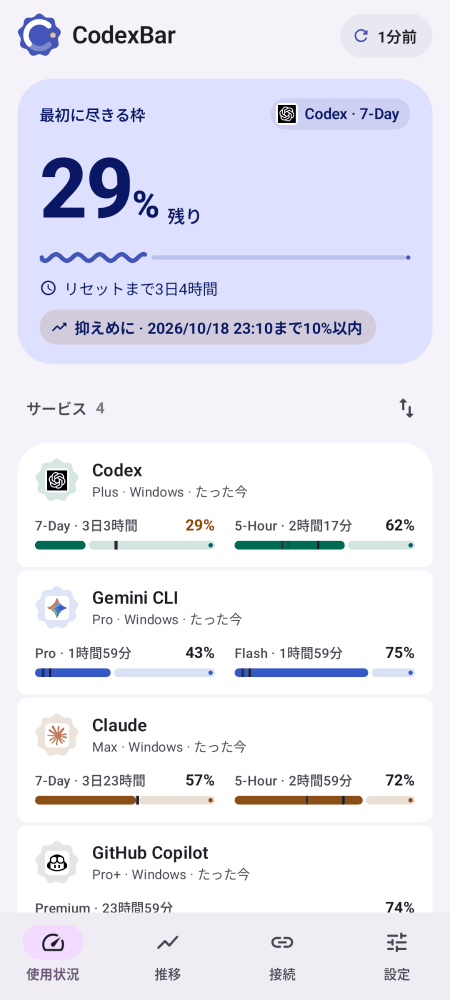
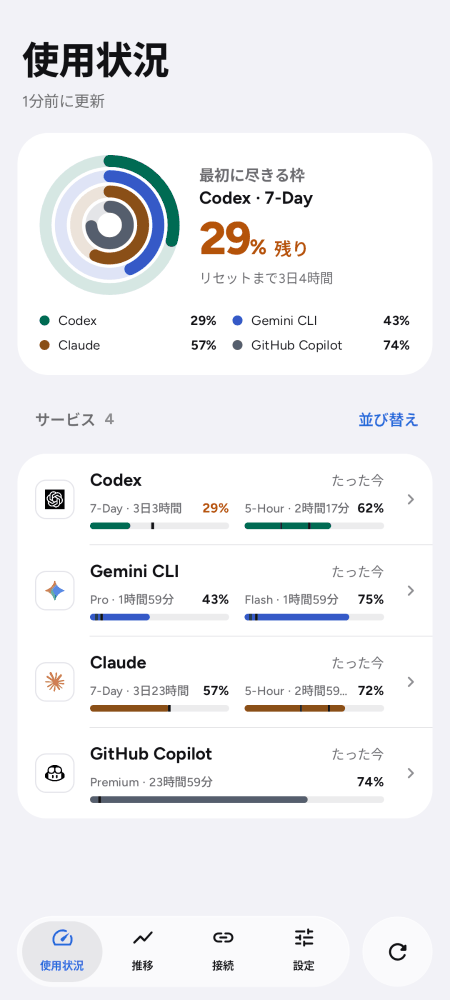
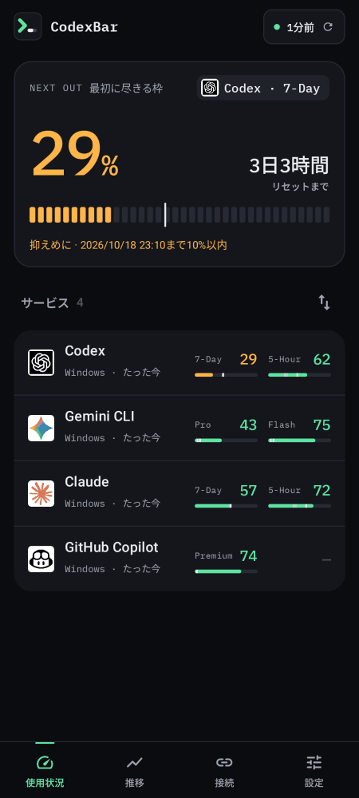
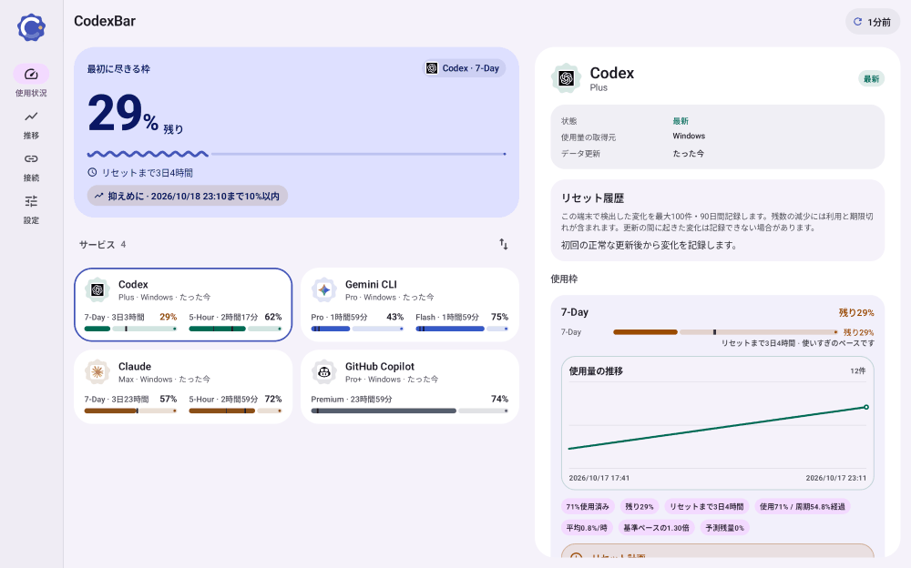
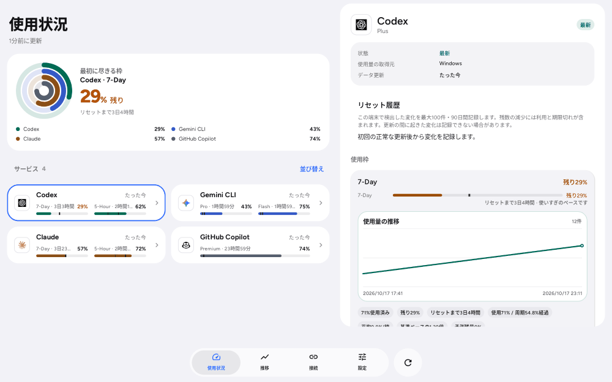
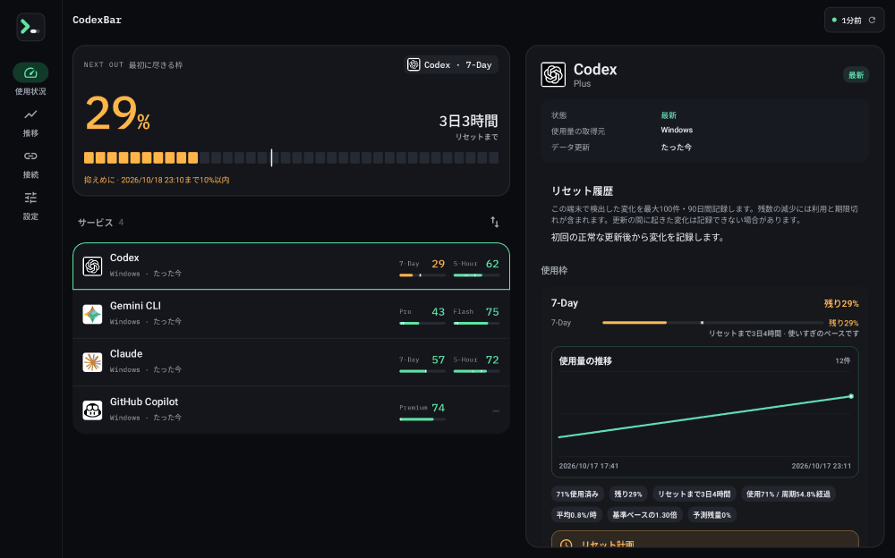
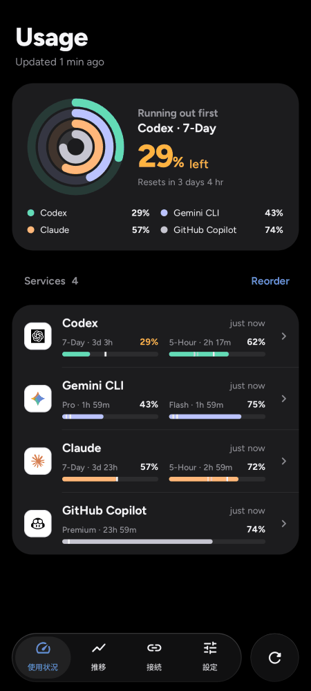

# デザイン刷新・検証記録

2026-10-30 の v0.11.1 では Liquid Glass を Glisse に合わせて更新しています。屈折・操作時のレンズ表現・新しい背景とカード、および最新のエミュレーター画像は [Glisse 版の実装・検証記録](liquid-glass-glisse.md) を参照してください。以下は従来デザインの記録です。

2026-10-17。Android アプリのデザインを 3 種類に絞って作り直し、更新中も操作できる画面、タブレット表示、デザイン連動のアプリアイコンを実装しました。この記録は実装時の検証です。リリース（バージョン番号の更新・署名・配布）は行っていません。

2026-10-18 のリリース前レビュー、修正、現在のエミュレーター撮影と配布検証は [v0.11.0 の記録](releases/v0.11.0.md) を参照してください。以下は当初の実装時点の記録です。

## 実装範囲

| 要望 | 実装 |
| --- | --- |
| デザインを 3 種類に | Material 3 / Liquid Glass / WinUI 3 / Aurora の 4 種類を、**Material 3 Expressive**・**Liquid Glass**・**Instrument** の 3 種類に置き換え。保存済みの WinUI 3 は Material 3 Expressive、Aurora は Instrument に移行。 |
| 「ぽい」だけでない表現 | Expressive はクッキー形・太い数字・波形バー・ギャップと終端ドット付きのバー。Liquid Glass はコンテンツを不透明にし、ナビゲーションだけを浮かせて背後を実際にぼかす（Android 12 以上。11 以下は不透明に代替）。Instrument は常時ダーク・IBM Plex Mono の数字・状態色だけで色分けしたゲージ。 |
| 更新中も操作できる | 取得元変更で画面全体を読み込み表示にしない。更新ボタンを無効化しない。引っ張って更新しても画面上にスピナーを残さない。カードごとに取得中を表示し、ヘッダーは「更新中 2/4」。タブを開くたびの再取得をやめ、1 分以上古いか言語が変わった時だけ更新。全タブで同じ ViewModel を共有。 |
| ヘッダー・フッター | ヘッダーはデザインのロゴ・アプリ名・更新状態ボタン。「並び替え」はサービス一覧の見出しへ移動。フッターは履歴と費用を「推移」に統合して 4 タブ。Liquid Glass は浮いたガラスのタブとリング付き更新ボタン。 |
| タブレット | ナビゲーションレール（Liquid Glass は中央のガラスバー）、2 ペインのダッシュボード、デザインごとの最小カード幅、本文幅に揃えた設定・接続のタイトル。 |
| アプリアイコン | デザインごとのアダプティブアイコン（テーマアイコン用のモノクロ層付き）。アプリがバックグラウンドに移った時に、選択中のデザインの起動エントリーだけを有効化。 |

フォントは Figtree と IBM Plex Mono を SIL OFL 1.1 で同梱しました（[出典とハッシュ](fonts.md)）。日本語は端末のフォントで表示します。

## upstream の確認

Android upstream `hyunnnchoi/CodexBar-android` の `main` は `1811d1fe032fd4a80240fd6bc5d04cee649a0afb` のままで、前回記録以降の upstream-only コミットはありません。取り込んだ変更・保留した変更はありません。このフォークの取得モード・保存済み接続・ウィジェット設定・署名・更新先・リリース手順は変更していません。

## 自動検証

| 検証 | 結果 |
| --- | --- |
| `:app:testDebugUnitTest`（`--dependency-verification=strict`） | 434 件中 432 成功・2 スキップ・失敗 0。追加したテストは、旧デザインの移行、各デザインの描画方針、起動エントリーとマニフェストの整合。 |
| `lint`（`--dependency-verification=strict`） | 成功。エラー 0・警告 129。今回の変更で増えた警告は解消済みで、既存の警告は残っています。 |
| `assembleDebug` | 成功。マージ後のマニフェストで起動エントリー 3 件のうち Expressive だけが有効なことを確認。 |
| 画面のレンダリング | 実際の Compose 画面を layoutlib（Paparazzi）で、スマホ（Pixel 6 相当）と Galaxy Tab S11 Ultra 相当の横向き 2960×1848 で描画して確認。この確認用の仕組みはリポジトリには含めていません。 |

## 実際の画面

[README](../README.md#three-designs) とこのフォルダの画像は、上記のレンダリング結果です。端末やエミュレーターでの撮影ではありません。データは合成です。

| Material 3 Expressive | Liquid Glass | Instrument |
| --- | --- | --- |
|  |  |  |

## 未確認の範囲と既知の制約

- この環境には KVM がなく、エミュレーターと実機で操作していません。特に、Liquid Glass のぼかしがスクロールに追従するか、ランチャーのアイコン切り替えにかかる時間は実機で確認が必要です。
- アイコンはアプリを閉じた時に切り替わります。ランチャーによっては反映まで数秒かかり、ホーム画面のショートカットが外れることがあります。
- Instrument はシステムのライト／ダーク設定にかかわらずダークです。
- 起動直後のウィンドウ背景は従来のままのため、Instrument ではアプリ表示前に一瞬明るい背景が見えることがあります。
