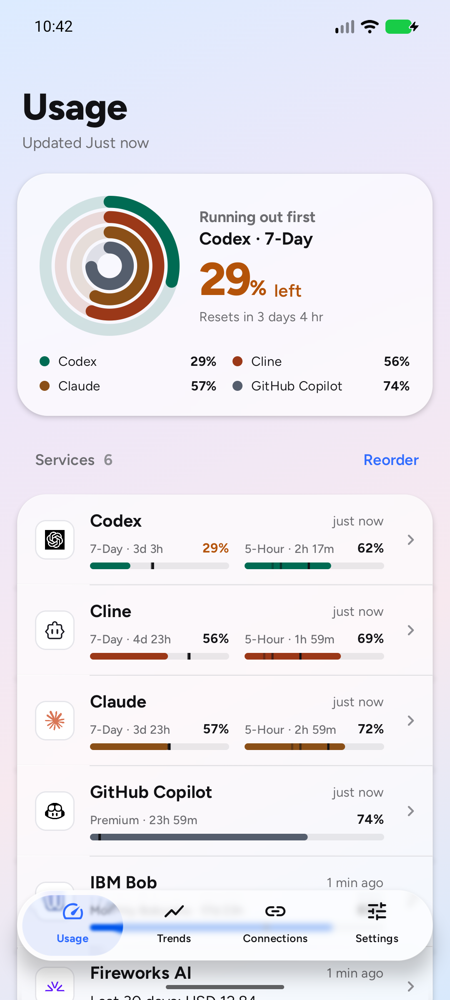
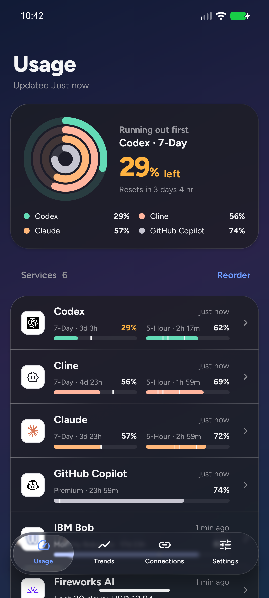
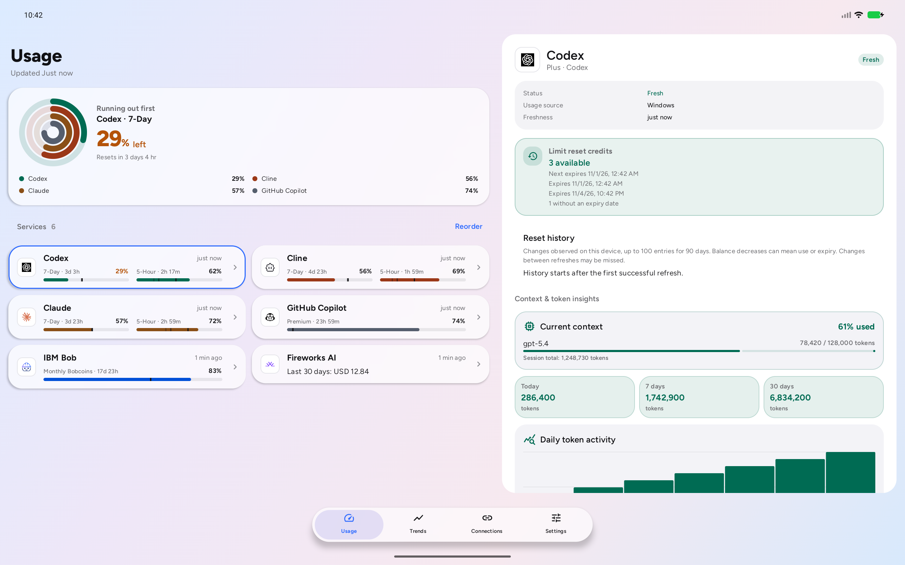
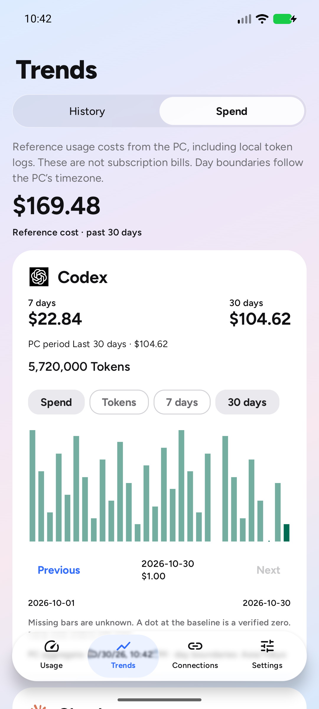
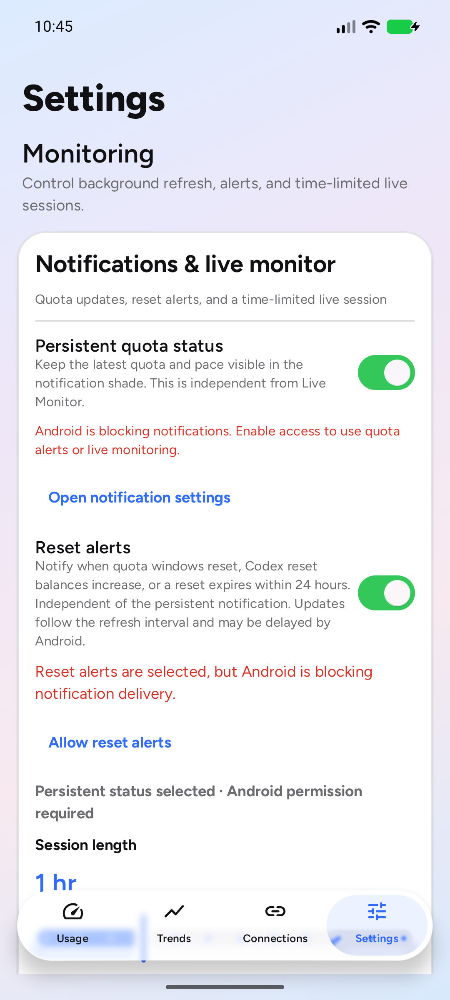

# Glisse-inspired Liquid Glass

Implementation verification, 2026-10-30. The design is included in [Android v0.11.1](releases/v0.11.1.md); that release record covers the versioned APK and current captures.

The Liquid Glass design follows the refraction, fine specular edges, floating capsules and pressed lenses in [Glisse](https://glisse.kelvinzhang.com/) by Kelvin Zhang ([source](https://github.com/0kzh/glisse), MIT). It is implemented natively in Compose; the app does not embed the website, a WebView or the React package. Its gradient backdrop is original, rather than a copy of the demo wallpaper. This is an adaptation to the existing CodexBar layout, not a claim of identical rendering to Safari/iOS.

## Rendering and controls

- Android 13+ uses an AGSL backdrop shader for edge refraction, subtle RGB dispersion and a directional highlight. Text and icons are drawn above the effect and stay sharp. The input is a recorded Compose graphics layer, not a screenshot of the screen.
- Android 12 retains native backdrop blur with a specular rim. Android 11 and earlier use opaque, readable surfaces. Irregular shapes and cards with unequal corner radii use the blur path instead of an incorrectly shaped lens.
- The overview and service cards sample a separate background-only layer. They never sample their own content. The full-screen gradient is shared in phone and two-pane tablet layouts.
- The floating tabs and refresh button lift with a spring while pressed. Tabs retain selected-state semantics and keyboard focus outlines. The refresh progress ring remains available in the live app; the deterministic preview does not provide the live refresh action.
- History/Spend uses a glass segmented track. Settings switches keep the native Material switch's input and accessibility behavior, with Glisse-inspired green tracks and glass thumb highlights in the Liquid Glass design.
- Source and consumer drawing boundaries remain isolated. Both source and panel origins are observable, so moved panels resample the correct part of a static backdrop without a continuous draw loop.

The native shader uses the Android [RuntimeShader/RenderEffect](https://developer.android.com/develop/ui/views/graphics/agsl/using-agsl) APIs. Material 3 Expressive and Instrument retain their existing rendering paths.

## Current emulator captures

All captures below are the real Compose UI from the debug-only screenshot harness, using synthetic quota/history/spend data. Phone: 1080 × 2400 at 420 dpi. Tablet: 2560 × 1600 at 240 dpi. Emulator: Android API 36.1, software renderer. These images do not represent live account data or physical-device acceptance.

| Light | Dark |
| --- | --- |
|  |  |





The new emulator has no notification permission; the Settings capture intentionally shows the existing permission-required messages. Notification delivery was not part of this design check.

## Upstream

Fetched read-only `hyunnnchoi/CodexBar-android` `main` at `1811d1fe032fd4a80240fd6bc5d04cee649a0afb`. There are no upstream-only commits relative to this branch, so there were no updates to incorporate or incompatible changes to defer. Acquisition modes, saved connections, widgets, signer, update endpoints and the release workflow are unchanged.

## Verification

- Strict dependency verification: `:app:testDebugUnitTest`, `:app:lintDebug`, `:app:assembleDebug` passed. 435 tests: 433 passed, 2 skipped, 0 failures/errors. Lint: 131 warnings, 0 errors. Existing compiler/lint warnings remain; these checks are not a warning-free claim.
- `scripts/verify-glass-rendering.py` passed on the final APK. Light mode: dashboard initial 1 frame / after scroll 0 frames; Spend initial 0 / after scroll 0, each measured over five idle seconds. The crash buffer remained empty.
- Dark mode also passed: dashboard initial 0 frames / after scroll 0; Spend initial 5 / after scroll 0, over five idle seconds. The verifier permits up to 8 occasional frames, rejecting sustained drawing. Both modes kept the process alive and had no recorded app crash.
- UI Automator confirmed the native glass switch exposes a checkable state and changes from checked to unchecked on a tap. The floating Trends tab navigated to a screen containing the History/Spend controls. Tests used only the disposable emulator.
- A source review checked API gating, nested layer dependencies, backdrop coordinates, tablet alignment and selected-state accessibility. Physical devices and the Android 12 / Android 11 fallback paths have not been exercised on devices in this change.

Reproduce the idle checks on a disposable emulator with the debug APK installed:

```sh
python scripts/verify-glass-rendering.py --serial <emulator-id> --adb <adb-path>
python scripts/verify-glass-rendering.py --serial <emulator-id> --adb <adb-path> --dark
```

The debug-only `.debug.ScreenshotActivity` accepts `theme=LIQUID_GLASS`, `dark_theme=true/false`, `analytics=true` and `destination=dashboard/spend/settings`. On Windows, an ASCII build directory outside OneDrive avoids AGP's non-ASCII path check and generated-resource access errors; verification used an exact source copy with build outputs outside the checkout.
