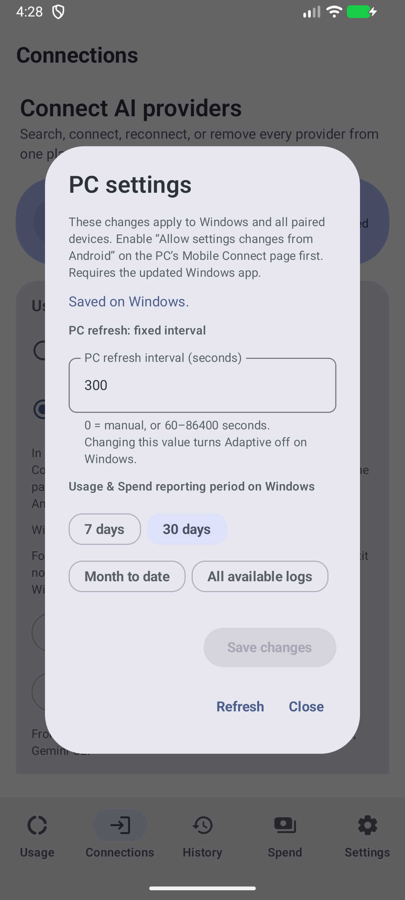
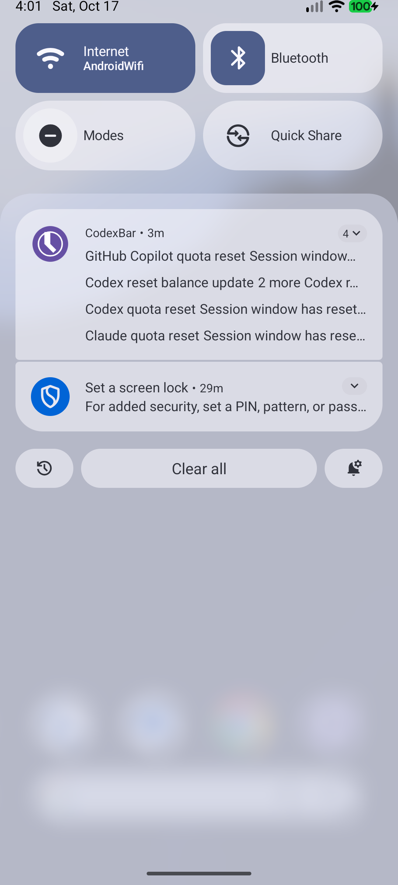

# モバイルダッシュボード更新・検証記録

2026-10-17。Android / Windows とも `codex/mobile-dashboard-history` で実装・コミットしています。この記録は公開前の実装検証です。正式配布はAndroid v0.10.0 / Windows v0.71.0として進め、署名と公開成果物の確認は[リリース記録](releases/v0.10.0.md)へ追記します。

## 実装範囲

| 要望 | 実装 |
| --- | --- |
| 並べ替え | ホームカードと並べ替え画面の長押しドラッグ。端の自動スクロール、TalkBackの移動操作、非表示サービスの位置保持。ウィジェットの順序編集にも共通UIを使用。 |
| 複数端末の履歴 | Windowsにアカウント・接続別の暗号化履歴を保存。最大90日保持し、最大30日の共通系列を端末へ送信。Androidのポーリング時刻で系列を増やさない。旧端末履歴をPCのアカウントへ推測で移さない。 |
| 費用とトークン | History / Spendタブ。PC側の集計期間、7/30日の参考費用・トークン、日別グラフ、集計日時。PCのタイムゾーンに従い、欠測と確認済みゼロを区別。費用はサブスクの請求額ではない。 |
| タブレット | 幅とカード数に応じたグリッド、一覧と詳細の2ペイン、費用カードの幅の有効活用。 |
| 使用量バー | 10dpへ拡大。既知の期間・リセット時刻がある枠には、均等配分した「現在・1時間後・次の現地深夜」の残量目安を表示。プロバイダーの保証値ではない。 |
| リセット通知 | 通知権限の初回要求、権限拒否・通知チャンネル停止・手動更新のみの状態を設定画面で案内。Windows取得でも通常更新・WorkManagerで同じ検出経路を使用。 |
| Windowsの共有UI | Advancedから独立したMobile Connect項目へ移動。動作状態とコピー操作を明確化。動作中のコピーをネイティブEXEで確認。 |
| PC設定操作 | PC側で許可した場合だけ、Androidから固定更新間隔・Usage & Spend集計期間を変更。固定間隔はAdaptiveをオフにする。同時変更は競合を返し、現在値を再読込。資格情報・ファイル・ペアリング・hooksは対象外。 |
| APK名 | 新しい正式配布は `CodexBar-Android-v<version>.apk` / `.aab`。タグと実際のversionNameをCIで照合。更新判定は旧 `app-release.apk` も認識。 |
| upstreamの継続確認 | 両リポジトリのAGENTS.mdに、毎回の開発前の確認・互換変更の統合・SHAと検証の記録を明記。常時監視や上流への書き込みは追加していない。 |

Android upstream `hyunnnchoi/CodexBar-android` は `1811d1fe032fd4a80240fd6bc5d04cee649a0afb` を確認、新規upstream-onlyコミットなし。Windows upstream `nesszer/Win-CodexBar` は `079b21a354ba55ec7757353792c8921f30dfa160`（328コミット）を通常mergeしました。費用推移・プロバイダー修正を取り込み、Gemini Appsの接続維持、Vivaldi、共有機能、フォークの設定保存先・更新先を保持しました。上流の未マージ機能ブランチは含めていません。

## 自動検証

| 検証 | 結果 |
| --- | --- |
| Android `:app:testDebugUnitTest` | 428件中426成功・2スキップ・失敗0。スキップ2件は専用ネイティブ接続テストで、別途実接続実行済み。 |
| Android `:app:lintDebug :app:assembleDebug` | 成功。Lintはエラー0・警告133。警告をすべて解消したという意味ではない。 |
| Androidのネイティブ相互接続テスト | Windowsの実際のTauri EXEに接続し、v1復号とv2の同時設定更新を2件成功・スキップ0で確認。2端末相当の同時変更は成功1・競合1となり、元の値へ復帰。 |
| Windows `cargo test --workspace` | core 4,841件、CLI 1件、Tauri 773件成功。既存の無視テスト2件。 |
| Windows `cargo clippy --workspace --all-targets -- -D warnings` | 成功。取り込んだJetBrainsの同値なbool式を現行Clippyに合わせて修正。 |
| Windowsフロントエンド | Vitest 1,337件 / 143ファイル成功。TypeScript・Viteビルド、1,740キーのlocale整合性チェック成功。Oxlintは終了0、上流由来の無関係な警告11件あり。 |
| ネイティブWindowsビルド | Tauri debug EXEをビルドして起動・撮影。分離した設定・WebView2保存先を使用し、インストール済み常駐アプリを維持。分離保存先が確認できないproof起動は単一起動保護を維持。 |
| APK名のバージョン照合 | 現行タグ `v0.9.8` は成功、不一致の `v9.9.9` は拒否。リリース自体は実行していない。 |

主な回帰対象は、取得元・資格情報変更中の遅延応答、同一観測時刻の非同期履歴完成と逆順応答、欠測・ゼロ・不正タイムゾーン、履歴スコープ分離、認証エラー時の独立した費用表示、ロック順序、v1互換、v2の改ざん・resource差し替え・競合です。セキュリティと並行処理、および最終のproof起動分離は読み取り専用レビューも実施しました。

## 実際の画面と操作

Android API 36.1エミュレーターで、スマホ1080×2400・タブレット2560×1600の画面を撮影しました。画面内の使用量は合成データです。[全画面](releases/mobile-dashboard.md)

- MainActivityでClaudeを長押しドラッグし、Codexの後ろへ移動。アプリを強制終了して起動し直し、順序が保存されていることを確認しました。プレビュー画面だけの順序変更ではありません。
- Windowsの公開合成データfixtureを実際のWorkManagerから取得。初回はリセット通知0件、データ変更後のバックグラウンド実行でCodex枠・Codexリセット残高増加・Claude・Copilotの4件を確認しました。
- Androidの実画面「PC settings」から、実際のWindows EXEの集計期間を7日に変更して保存成功を確認し、30日に戻しました。PC側の許可は分離した合成設定だけで有効にしました。
- Windowsの専用Mobile Connect画面で、共有実行中のコードコピーを実行し、成功表示を確認しました。

  
  

## 残っている受け入れ確認

- 物理スマホ・タブレット、OEMの省電力制限、Samsung Now Bar、実際の外出先Tailscale回線での通知到達は未確認です。今回のエミュレーター・loopback検証を代用として扱いません。
- 長い一覧の端スクロールとTalkBackは実装・ビルド確認済みですが、実機の操作受け入れは未完了です。
- PCが停止・スリープ・到達不可の間は取得できません。Androidの更新スケジュールに従うため即時プッシュではなく、観測できなかった期間の全リセットを再現するものではありません。
- PC履歴は更新後の観測から蓄積します。費用表示はコスト集計を有効にした対応サービスが対象です。すべてのサービスでトークン・費用を取得できるわけではありません。
- Windows EXEは署名なしです。この作業では公開、Firewall/VPN変更、Gemini再起動、既存常駐EXEの置き換えを行っていません。

## コミット記録

以下はこの記録を追加するドキュメントコミットより前の実装コミットです。件名と目的をリポジトリ別に記録しています。

### Android commits

| SHA | 件名 | 目的 |
| --- | --- | --- |
| `f385e94` | docs: require upstream review for each development task | 開発ごとの上流確認を作業規約へ保存 |
| `bb0d6c1` | fix: name Android downloads with product and version | APK/AABの製品名・バージョン入り配布と旧名互換 |
| `a64d738` | feat: drag reorder adaptive provider cards | 長押しドラッグ、順序保持と可変グリッド |
| `d479f76` | feat: show readable quota bars with time budget guides | 太い使用量バーと時間別残量目安 |
| `72012c8` | fix: expose blocked reset alerts and request notification permission | 通知権限・チャンネル・更新停止の案内 |
| `49d8cce` | feat: consume canonical PC quota history and daily spend | 共通PC履歴と日別費用のデータ契約 |
| `e1dbfe1` | fix: reject older canonical PC history observations | 古いPC履歴の逆順応答を拒否 |
| `1e8ce7d` | fix: retain PC spend independently of quota authentication | 認証待ちでも独立したPC費用を保持 |
| `db33371` | feat: add adaptive history and PC spend dashboards | History / Spend画面と日別グラフ |
| `5fc6ec1` | fix: capture PC spend before locking source publication | 取得元切替とPC費用公開のロック順序を統一 |
| `9f84172` | fix: reject unsupported PC spend timezones before rendering | 不正なPCタイムゾーンから描画を保護 |
| `b61e18e` | feat: size analytics cards for the available tablet content | タブレットのカード数に合わせた幅調整と撮影データ |
| `b93dd8a` | feat: control opted-in PC refresh and spend settings | 許可制のPC設定変更と接続切替中の応答分離 |
| `a494467` | fix: keep quota guide labels readable on phones | スマホのバー凡例の重なりを解消 |
| `13c899e` | test: verify native PC control and background reset delivery | ネイティブ暗号通信・設定競合・背景通知の実行検証 |
| `145b80b` | fix: bind versioned APK names to the actual app version | タグとAPK内のバージョン不一致をCIで拒否 |
| `7502c73` | fix: accept completed PC history without late rollback | 同一時刻の履歴書込完了を許可し、遅延応答で戻さない |
| `04f69f6` | docs: point Android pairing to the Mobile Connect pane | 新旧Windowsの設定場所を接続案内に反映 |
| `63c36fb` | test: exercise Android controls against the isolated native listener | 実際のWindows EXEへエミュレーターから接続する検証口 |
| `1172935` | fix: keep every PC reporting period visible on phones | PC設定の全期間を折り返し表示し内部値を非表示 |

### Windows commits

上流328件はmergeコミットにまとめ、ここではフォーク側のfirst-parent列を示します。

| SHA | 件名 | 目的 |
| --- | --- | --- |
| `2c37e06d0` | Merge upstream main for spend trends and provider fixes | 上流の費用推移・プロバイダー修正を通常merge |
| `c5b12f645` | docs: require upstream review before fork development | フォーク機能を保持した毎回の上流確認を明記 |
| `42bd76875` | feat: give Mobile Connect a dedicated settings pane | 専用Mobile Connectタブと状態・コピー操作 |
| `398217f71` | feat: persist and share account-bound PC history and spend | アカウント別PC履歴保存、日別費用と背景集計 |
| `7b1aaad81` | feat: allow authenticated opt-in mobile settings changes | v2認証・許可制設定操作と同時変更の競合検出 |
| `b146a8bd2` | fix: keep upstream quota guards compatible with strict Clippy | 上流のクォータ防御式を厳格Clippyと両立 |
| `95595f62d` | test: isolate native proof runs and seed background reset fixtures | 常駐を残す検証起動と合成リセットfixture |
| `0be8d8a37` | fix: describe Gemini Apps accurately in sharing help | Gemini Apps / CLIの区別を共有画面にも反映 |
| `60e17e575` | fix: require a separate store before bypassing single-instance protection | 通常設定と異なる保存先でのみ検証の複数起動を許可 |
