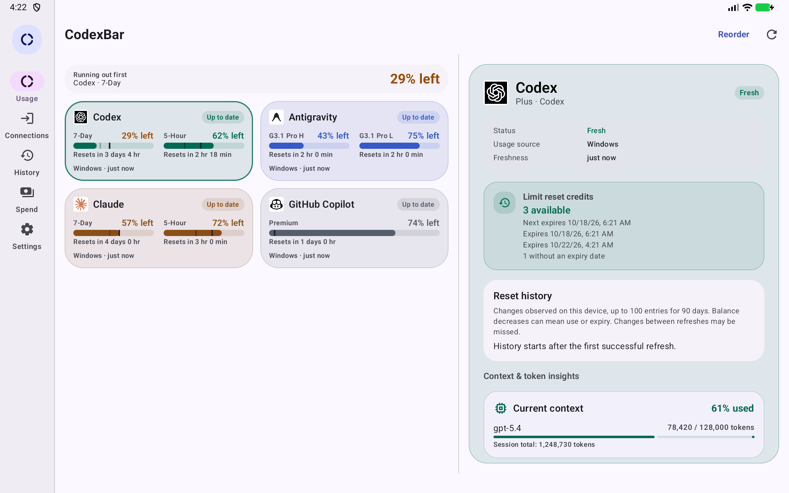
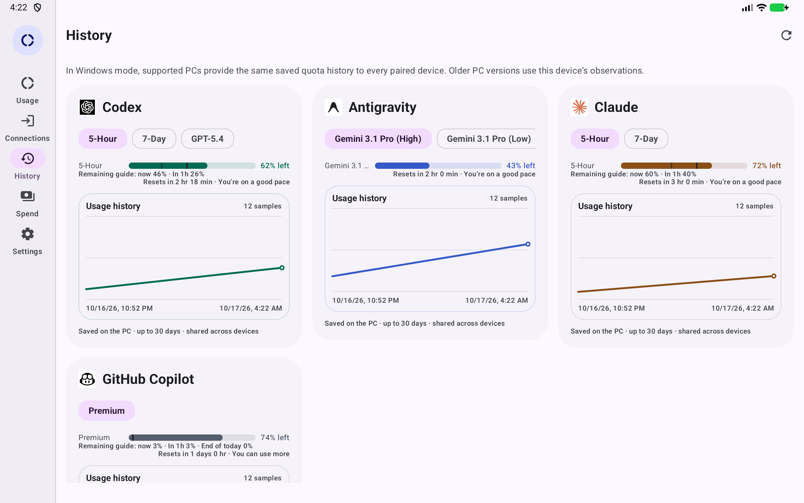
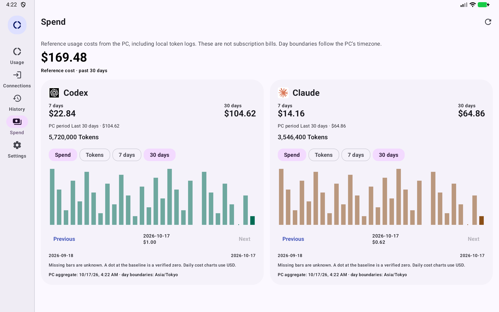
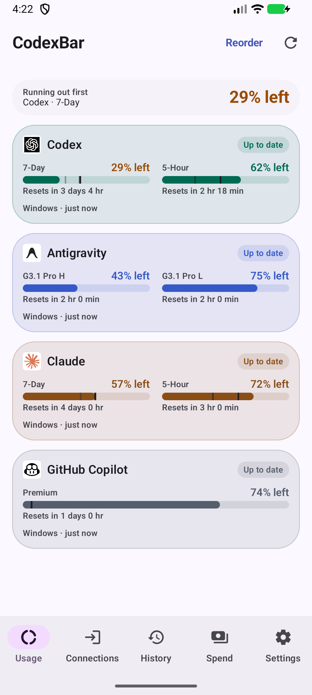
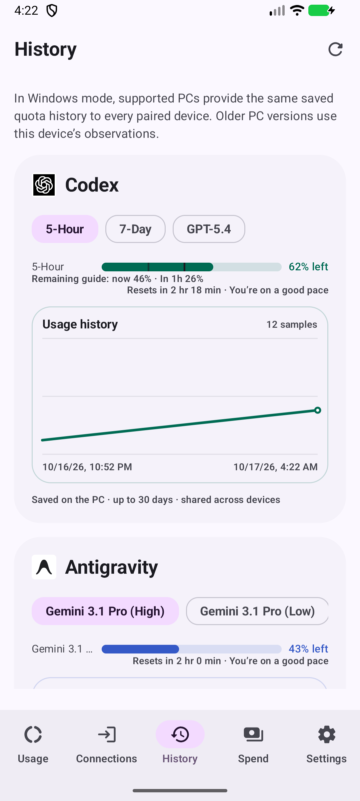
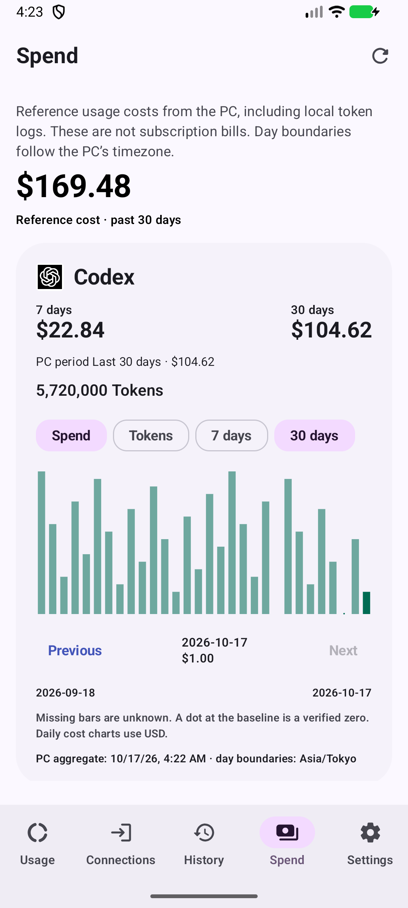

# Mobile dashboard implementation record

This implementation is included in [Android v0.10.0](v0.10.0.md) and Windows v0.71.0. Both apps need the update for shared history, spend and remote settings. Older versions remain compatible with basic quota sharing.

- Long-press a home card or an item in **Reorder**, then drag it to its new position. Edge scrolling handles long lists. TalkBack offers move actions. Filtered-out providers keep their slots; widget order editing uses the same interaction.
- **History** receives the PC's canonical quota observations rather than generating different samples on each phone. Windows keeps encrypted account/connection archives for up to 90 days and shares a bounded 30-day series. This history starts when the updated PC observes usage; older device histories are not guessed into a PC account. Gemini Apps has a connection-bound history scope without pretending to have a verified Google account ID.
- **Spend** shows PC reference costs and token totals for 7/30 days and the PC's selected reporting period, plus daily charts. Multiple accounts can contribute to PC logs. These are reference usage costs, not subscription invoices. Missing data is unknown, verified zero stays zero, and incomplete token scans are marked as a lower bound. Daily charts follow PC calendar dates and show 7 or 30 calendar days, including gaps.
- The home grid and History/Spend cards adapt to tablets. The 10dp quota meters include remaining-budget guides for now, one hour later and the next local midnight when the quota duration/reset is known. Guides assume an even budget across the quota window; they are not provider guarantees.
- Reset alerts request Android notification permission once after a source is connected. Settings explains a denied permission, a blocked reset channel, or manual-only refresh. Foreground and WorkManager updates use the same source/account detection. Android scheduling, connectivity and battery restrictions still determine when a changed quota is observed.
- Windows now has **Settings → Mobile Connect**, with clear listener status and a prominent pairing-code copy action. Multiple phones/tablets can keep the same code. Revoking it disconnects all devices.
- Android **Connections → PC settings** can change the PC's fixed refresh interval and Usage & Spend period after Windows enables **Allow settings changes from Android**. Choosing a fixed interval turns Adaptive off. Conflicting changes from another device load the current values for review. Credentials, pairing, addresses, files and hooks are not remote-editable.
- New signed release assets use **`CodexBar-Android-v<version>.apk`** and the equivalent AAB name. Checksums and attestations cover those files. The updater recognizes the versioned name while still accepting older releases' `app-release.apk`.

## Screens

These are real Android API 36.1 emulator captures with synthetic data, not physical-device acceptance or screenshots of a published release.

  
  
  

## Upstream

Android upstream `hyunnnchoi/CodexBar-android` was checked at `1811d1fe032fd4a80240fd6bc5d04cee649a0afb`; there were no new upstream-only commits. Windows mainline `nesszer/Win-CodexBar` was merged at `079b21a354ba55ec7757353792c8921f30dfa160`, including its spend trends and provider fixes while preserving this fork's Gemini Apps renewal, Vivaldi, Mobile Connect and owned updater/configuration. Future development must repeat this review as recorded in both repositories' `AGENTS.md`.

See [the implementation and verification record](../mobile-dashboard-validation.md) for commits, checks and remaining acceptance boundaries.
