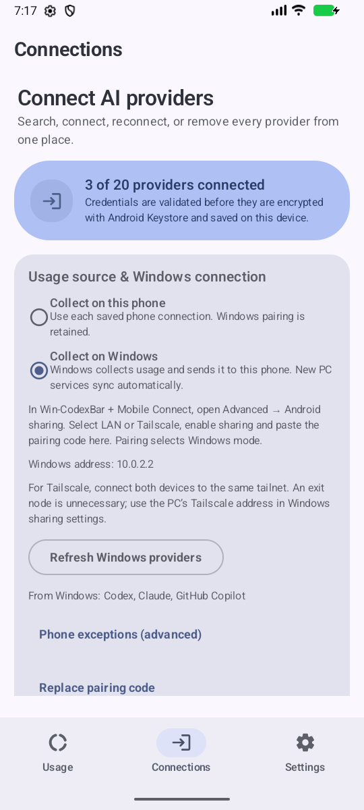

# v0.9.7 validation and commit purposes

- Android local checks: `testDebugUnitTest`, `lintDebug`, and `assembleDebug` passed: 408 tests passed, one native interop test skipped without its private endpoint.
- The forced native interop test separately passed against both the actual Windows loopback listener and its detected Tailscale address, including PC token/cost totals.
- Native Android API 36.1 screenshots show phone/Windows modes, retained pairing, three Windows providers and PC detail totals. A freshly rebuilt APK also verified readable dark-mode headings. Screenshot fixtures are synthetic and contain no provider secrets.
- Legacy/source/account history migration, pending writes, mode exceptions, source revisions, deleted/reconnected OAuth credentials, optional phone collectors, PC payload bounds and privacy redaction have focused regression coverage.
- Pages asset/link validation passed. The additional section was checked in the actual browser at 390px with loaded images and no horizontal overflow.
- Windows locked workspace tests passed: 4,178 core, one CLI and 715 Tauri tests; one core test intentionally ignored. Formatting/clippy and frontend build passed. The final hosted Windows CI reruns frontend tests and builds its portable static-CRT EXE.

Release APK/AAB signing, checksums, SBOMs, provenance, attestations, tag binding and upgrade installation are verified separately after hosted publication. Existing v0.9.6 signing identity is pinned. This report does not turn local debug artifacts into published release evidence.

Physical phones, off-LAN physical Tailscale, live provider accounts, launcher widgets, tray-menu pixels and Samsung Now Bar acceptance remain unverified. CUA Driver is unavailable; Windows native pixels came from Windows.Graphics.Capture. Google Gemini Apps usage is unsupported; Gemini refers to Gemini CLI. Windows is unsigned and updates are manual.

## Commits

Each subject states the independently reviewable purpose; no history was rewritten.

| Commit | Purpose |
| --- | --- |
| `ff8f316` | feat: persist explicit phone and Windows acquisition modes |
| `0cc71c4` | fix: retain separate source histories when acquisition modes change |
| `58ea601` | fix: preserve legacy source ownership and pending history samples |
| `8346091` | feat: synchronize Windows acquisition sources before each refresh |
| `a9fc6af` | feat: validate PC local totals and redact them in private views |
| `9c42f33` | feat: explain acquisition modes and display PC local usage details |
| `e35299d` | fix: serialize token rotation with credential deletion and source changes |
| `0581b1e` | fix: retain phone exceptions across acquisition mode round trips |
| `d984b7b` | fix: stop optional phone collectors after Windows source switches |
| `7d49605` | test: verify local token and cost totals from the native Windows bridge |
| `305a3fa` | fix: keep phone mode independent from automatic PC discovery |
| `e7c83fa` | fix: discard stale OAuth failures after source and credential changes |
| `f123a38` | test: update notification source fixture for acquisition settings |
| `63754ad` | fix: keep connection headings readable in dark themes |

## Published Android release verification

[Android Release run 38475338690](https://github.com/lingmulongtai/CodexBar-android/actions/runs/38475338690) succeeded. [v0.9.7](https://github.com/lingmulongtai/CodexBar-android/releases/tag/v0.9.7) is public, stable and latest, tagged at PR #58 merge `0dd4d7b693ce05b0e0db4efcf52b62b85814023f`.

All 18 payload SHA-256 hashes passed after downloading the 19 release assets. The verified GitHub attestation also binds all 19 assets, including SHA256SUMS, to the exact tag commit. APK and AAB signatures match the pinned production certificate `3ea66ed2f88daf035f3feb470d1dcb397f8e33f1593d302f662eb20ab5ec608f`. APK package/version is com.codexbar.android / 0.9.7 / version code 32; the release manifest excludes ScreenshotActivity and WidgetHostActivity. All five CycloneDX SBOMs parsed and all four companion archives contain package version 0.9.7.

The downloaded signed APK installed over signed v0.9.6 without uninstalling on the dedicated API 36.1 emulator. Windows mode, saved host 10.0.2.2 and three Windows services survived. The app remained running without a crash. This is upgrade/emulator evidence using synthetic Windows data, not physical-phone or live-account acceptance. Windows distribution rolls forward to v0.70.2 after its portable-runtime gate correction; the Android binary/tag remains unchanged.

Additional documentation/metadata commit: `3707533` — chore: prepare Android 0.9.7 with current mode screenshots.
