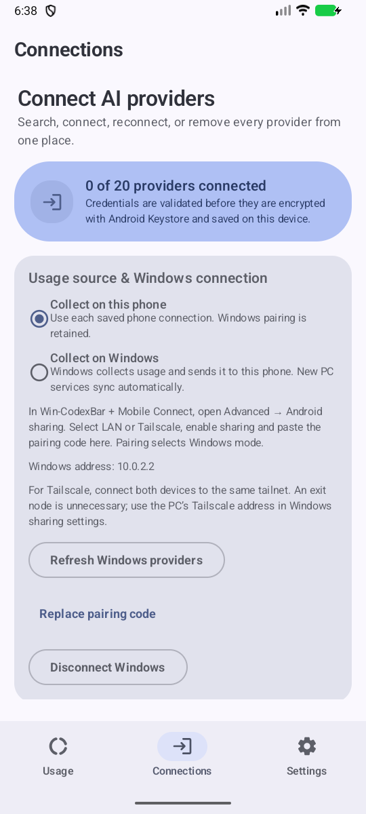

# CodexBar for Android v0.9.7

Choose where usage is collected: **on this phone** or **on Windows**. The companion is now **[Win-CodexBar + Mobile Connect](https://github.com/lingmulongtai/Win-CodexBar-Mobile-Connect)**, with a directly downloadable Windows EXE and stable releases.

- Windows mode receives all known enabled PC providers automatically at refresh, including providers that need authentication. Optional phone exceptions keep selected services on their saved phone connection.
- Switching modes preserves phone credentials, Windows pairing, exceptions and separate source/account histories. Old selected-provider lists migrate to phone exceptions. **Use Windows for all services** explicitly clears exceptions.
- PC local-log token counts and estimated USD costs appear in provider details, where available: today, trailing 30 days and the selected PC reporting period. The PC calendar date and aggregation timestamp are displayed. These totals may include multiple accounts and are separate from the quota account and billed charges.
- Windows sharing can select the PC's Tailscale address. Both devices need the same tailnet, permitted access rules/firewall and a running PC; **the phone does not need an exit node**. LAN also works.
- Offline Windows does not fall back to a different phone account. Late results cannot publish after source/deletion changes; same-account in-flight OAuth token rotation is retained without restoring deleted credentials.
- Legacy chart/reset history is archived before switching, preventing migration data loss or account mixing. Stale observations do not create new history or alerts.

  
  
  

Install **app-release.apk** over the existing app without uninstalling. Version code **32** retains the pinned production signer and saved connections. Windows and Android releases have separate version numbers: Windows **v0.70.1**, Android **v0.9.7**. The Windows EXE is unsigned.

Validation uses synthetic quotas/log totals in the actual native Windows app and Kotlin receiver, Tailscale-address listener/receiver checks, Android API 36.1 mode switching and screenshots, source/migration/concurrency/privacy tests, Lint and builds. Desktop captures use Windows.Graphics.Capture because CUA Driver is unavailable. Screenshots are emulator evidence; physical-phone, off-LAN physical Tailscale, real-account, launcher, tray-menu and Samsung Now Bar acceptance remain unverified.

**Gemini is Gemini CLI. Google Gemini Apps / the Windows Gemini app's usage is not collected.** Pairing codes and provider credentials are absent from screenshots. The debug capture activities are excluded from signed release builds.

Assets include signed APK/AAB, companion archives, SBOMs, current screenshots, SHA-256 checksums, provenance and artifact attestations.

**Full changelog:** https://github.com/lingmulongtai/CodexBar-android/compare/v0.9.6...v0.9.7
