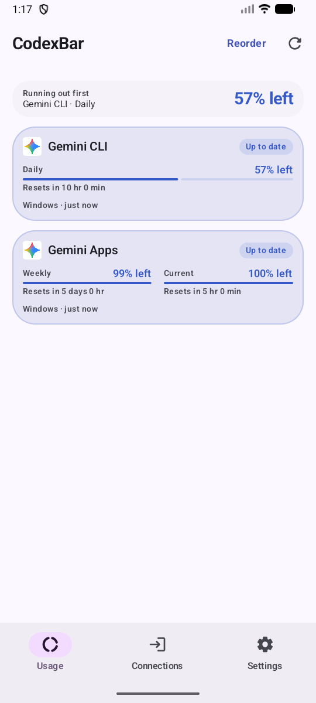
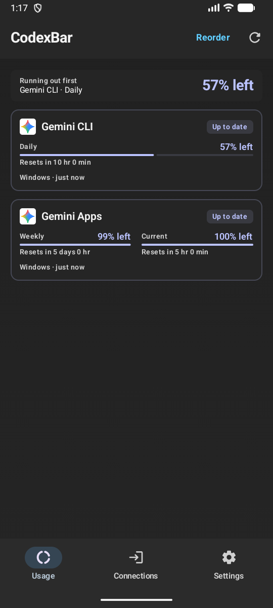
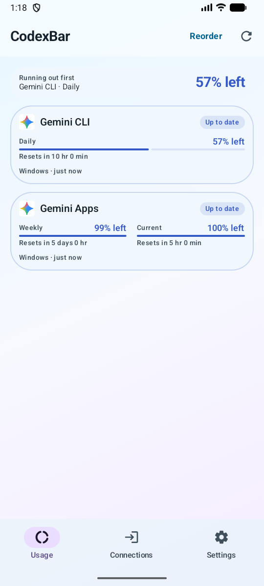

# CodexBar for Android v0.9.8

**Google Gemini Apps usage now arrives from Windows**, separately from Gemini CLI and Antigravity. Use [Win-CodexBar + Mobile Connect v0.70.6 or later](https://github.com/lingmulongtai/Win-CodexBar-Mobile-Connect/releases/latest), which fixes the Gemini connection transport error and retains encrypted session renewals. If an older connection already expired, reconnect once after updating Windows.

- Display the Current (5-hour) and Weekly quota, each reset time, Windows source and observation freshness. Zero usage is retained; missing values stay unknown.
- Existing Gemini connections keep their saved `GEMINI` ID and are named **Gemini CLI**. Other providers' notification IDs and saved connections are preserved.
- Gemini Apps uses Windows acquisition. Its connection card explains setup instead of asking for a Google credential on the phone. Phone-only mode never substitutes Gemini CLI quotas.
- Your phone and tablet can pair with the same Windows code concurrently. Tailscale works without an exit node when both can reach the selected PC address. Revoking pairing invalidates the shared code on all devices.

On Windows, sign in to the official Google Gemini app, close it once, enable Gemini Apps in Win-CodexBar and connect. Reopen Gemini after successful verification; subsequent refreshes use the saved encrypted session while Gemini runs. On Android choose **Connections → Acquisition → Windows**. [Complete connection instructions](https://github.com/lingmulongtai/Win-CodexBar-Mobile-Connect/blob/main/docs/gemini-apps.md)

  
  
  

These are fresh screenshots of the real Android app on the dedicated API 36.1 emulator, with explicitly synthetic quotas. Six images cover the four supported themes and light/dark variants. Synthetic Gemini Apps history and pace are omitted. Screenshots contain no Google sessions, account names or pairing secrets; debug capture activities are excluded from the signed release.

Local validation: **412 unit tests passed**, including CLI/Apps separation, quota/reset mapping, acquisition modes, registry coverage and release-version consistency. **Lint, fresh debug APK build and landing-page validation passed.** Desktop browser checks verified the new instructions, loaded images and readable cards; a 390px viewport DOM check found no horizontal overflow.

Install **app-release.apk** over the existing app. Version code **33** retains the production signer. Assets include the signed APK/AAB, companion archives, screenshots, SBOMs, checksums, provenance and attestations.

The Google quota API is undocumented and may change. This integration supports the primary/default Google account, current/weekly usage and resets. It does not report per-model token usage or a verified Google account identity, so account-dependent Gemini Apps reset-history tracking is omitted. Google credentials stay on Windows. Physical-phone/tablet, off-LAN physical Tailscale, launcher and Samsung Now Bar acceptance remain separate from emulator and unit checks.

**Full changelog:** https://github.com/lingmulongtai/CodexBar-android/compare/v0.9.7...v0.9.8
